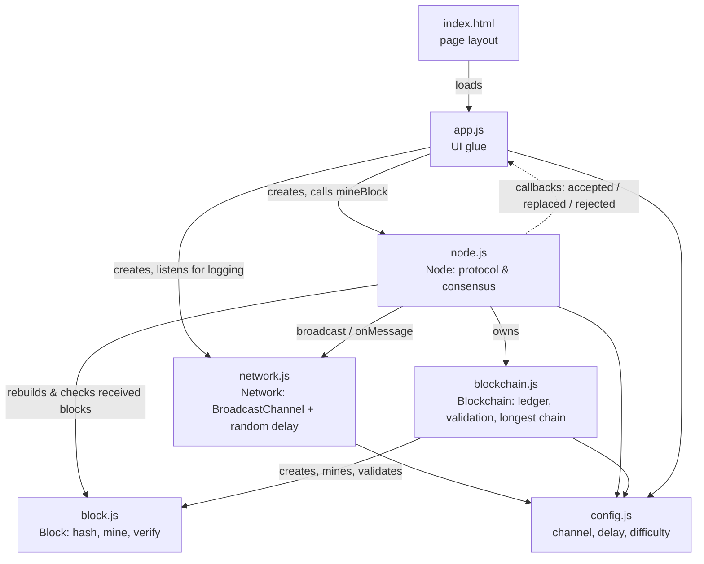
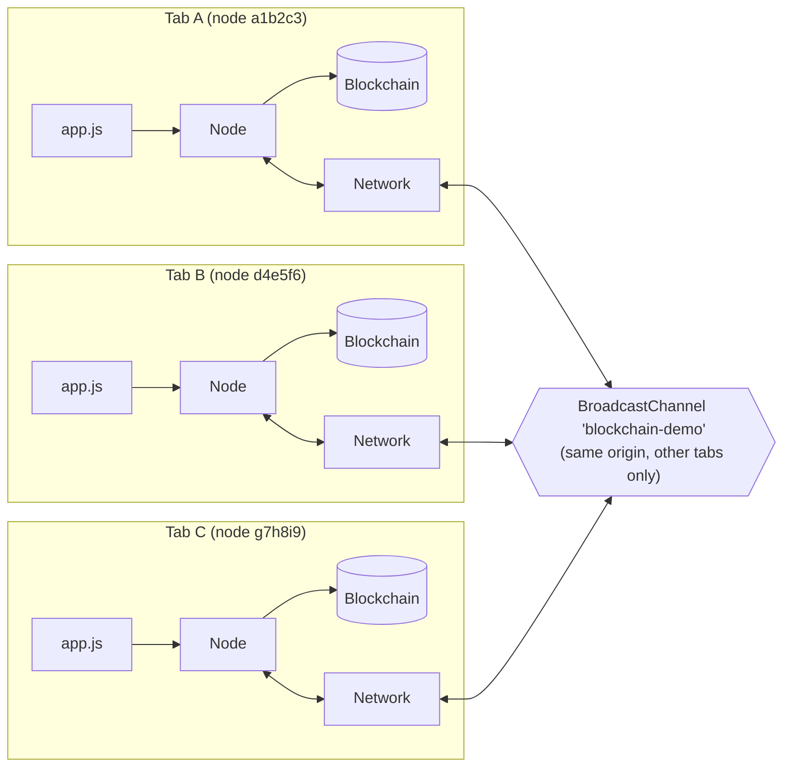
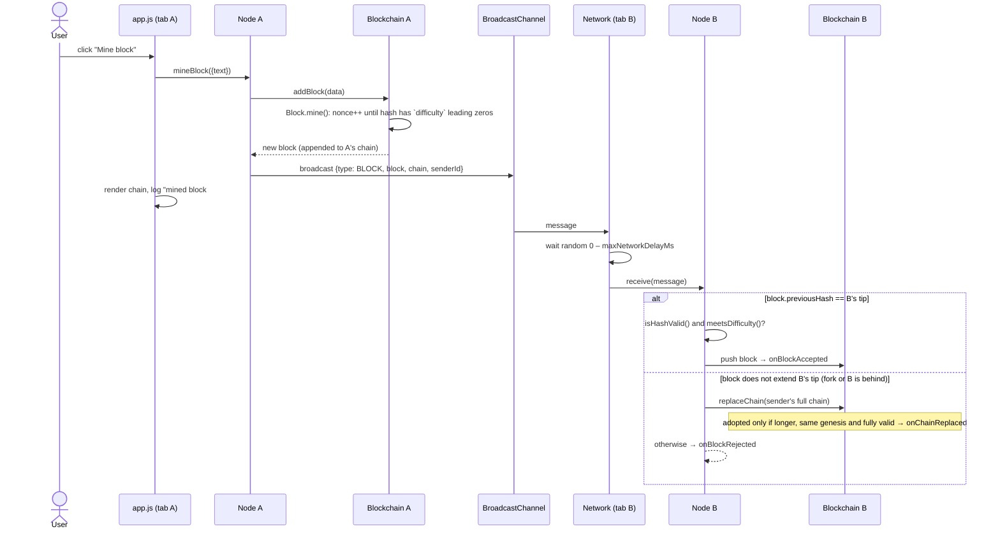

# Blockchain demo — how the code is organised

A dependency-free blockchain that runs entirely in the browser. Every browser
tab running `index.html` is an independent **node**: it keeps its own copy of
the chain, mines blocks with proof-of-work, broadcasts them to the other tabs,
and resolves forks with the longest-chain rule.

The walkthrough and the fork experiment are in
[`../../blockchain-demo.md`](../../blockchain-demo.md). This file explains the
code.

## Components

| File            | Component    | Main role                                                                                                                                                    |
| --------------- | ------------ | ------------------------------------------------------------------------------------------------------------------------------------------------------------ |
| `config.js`     | `config`     | The knobs of the experiment: the `BroadcastChannel` name, the maximum simulated network delay (`maxNetworkDelayMs`), and the proof-of-work `difficulty`. |
| `block.js`      | `Block`      | The data unit. Computes the SHA-256 hash of `index + previousHash + timestamp + data + nonce` (Web Crypto), **mines** by incrementing the nonce until the hash starts with `difficulty` zeros, and checks a block on its own (`isHashValid`, `meetsDifficulty`). |
| `blockchain.js` | `Blockchain` | The ledger: an array of blocks starting from a fixed **genesis** block. Appends newly mined blocks (`addBlock`), validates a whole chain (`isChainValid`: hashes, links, difficulty), and implements the **longest-chain rule** (`replaceChain`). |
| `network.js`    | `Network`    | The transport. Wraps a `BroadcastChannel`, so a message posted by one tab reaches every *other* tab of the same origin. Each incoming message is delivered after a **random delay** (0 – `maxNetworkDelayMs`) to imitate a slow, unordered network. |
| `node.js`       | `Node`       | The protocol / consensus logic. Owns a `Blockchain` and a `Network`. When it mines, it broadcasts a `BLOCK` message carrying the new block **and its full chain**. When it receives one, it decides: append, replace its chain, or reject. Reports the outcome through the callbacks `onBlockAccepted`, `onChainReplaced`, `onBlockRejected`. |
| `app.js`        | UI glue      | Entry point. Gives the tab a random node id, creates the `Network` and the `Node`, wires the "Mine block" button to `node.mineBlock()`, and renders the chain and the log from the node's callbacks. Contains no blockchain logic. |
| `index.html`    | Page         | The page layout (data input, "Mine block" button, chain list, network log) that loads `app.js` as an ES module. |

## How the components relate

Dependencies between the modules (an arrow means "uses"):



At run time, several tabs form the network. Each tab has the same stack;
the only thing they share is the browser's `BroadcastChannel`:



## What happens when you click "Mine block"



The receiving node's decision in `Node.handleBlock()` is the heart of the
consensus:

1. **The block extends my tip** → check it on its own (hash matches content,
   proof-of-work is sufficient) and append it, or reject it.
2. **It doesn't** → the sender may be on a different branch, or ahead of me.
   Since every `BLOCK` message also carries the sender's whole chain, try the
   **longest-chain rule**: adopt that chain if it is longer than mine, starts
   from the same genesis block and is valid from end to end.
3. Otherwise → reject the block (e.g. a shorter competing branch).

## Running it

ES modules and `crypto.subtle` do not work from `file://`, so serve the
folder over HTTP, e.g.:

```bash
cd docs/BC/code/blockchain-demo
python3 -m http.server 8000
```

Then open `http://localhost:8000/` in two or more tabs. To make forks easier
or harder to trigger, change `maxNetworkDelayMs` and `difficulty` in
`config.js`.

## Simplifications (good starting points for exercises)

The demo is deliberately minimal. Compared to a real blockchain:

- **No transactions, signatures or rewards:** `data` is free text and anyone
  can mine anything.
- **Whole chain in every message:** real nodes send only the block and ask for
  missing ones on demand.
- **Longest chain, not most work:** with a fixed difficulty the two are the
  same, but real systems compare accumulated work and adjust the difficulty.
- **No synchronisation on start-up:** a tab opened later only catches up when
  it receives the next block.
- **Mining is not interrupted:** if a block from another node is accepted
  while this node is still mining, the freshly mined block is appended
  anyway on top of the old tip, so the local chain becomes inconsistent until
  a longer valid chain replaces it. Fixing this (stop mining when the tip
  changes, or re-check the tip before appending) is a good exercise.
- **Mining runs on the page's main thread:** a Web Worker would keep the UI
  fully responsive at higher difficulties.
