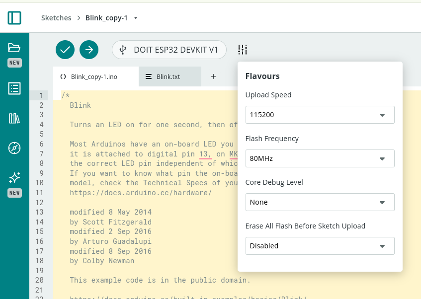
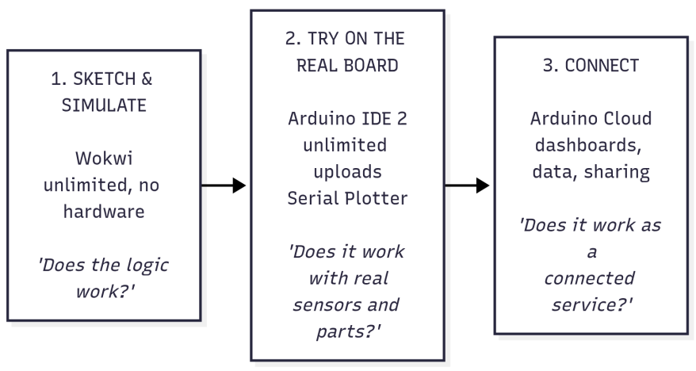

# IoT for Product Design

> 📊 **Course Slides:** [Download Presentation Slides (PDF)](assets/slides.pdf) | [View Slide Source (Marp Markdown)](assets/slides.md)

## 1. Purpose

This set of exercises introduces product design students to the Internet of Things (IoT) through hands-on work with ESP32 boards programmed in Arduino. It has two goals:

1. **From smart objects to ecosystems.** Show that sensors, actuators and connectivity let us build an *ecosystem of cooperating objects*, not just isolated smart objects. The value comes from the relationships between objects, people and services.
2. **From data to better products.** Show that the data IoT devices collect can improve the **design, development, use and maintenance** of a product or service, closing the loop between the designer and the product in the field.

The path goes step by step. Each exercise introduces **one or two new concepts** and reuses the skills from the previous ones. Every exercise ends with a short **design reflection**, because the aim is to train designers who understand what the technology makes possible, not to train embedded engineers.

To minimize the burden of installintools,  all the connected parts of the course (connectivity, dashboards, phone control, data storage, notifications, remote updates) are done on a **single platform: Arduino Cloud**. The class is made of designers with little experience of programming tools, so the priority is to keep the number of tools, accounts and concepts as low as possible. Three tools are used, each with a clear role:

| Tool                                                                  | What it is for                                                                  | Limits                                                  |
| --------------------------------------------------------------------- | ------------------------------------------------------------------------------- | ------------------------------------------------------- |
| **[Wokwi](https://wokwi.com/)** (browser simulator)                   | Sketching and trying behaviour, with no hardware and no risk                    | Limited number of simulations on the Free plan          |
| **[Arduino IDE 2](https://www.arduino.cc/en/software)** (desktop app) | Free experimentation on the real board, Serial Plotter, unlimited uploads       | Does not create dashboards                              |
| **[Arduino Cloud](https://cloud.arduino.cc)** (browser + phone app)   | The connected object: cloud variables, dashboards, phone control, data, sharing | Limited number of compilations per day on the Free plan |

Because Arduino Cloud limits the number of compilations per day, students learn early to **try things in Wokwi and the Arduino IDE, and to use the Cloud only for the "connected" version** of their work (§5.3).

To run Arduino Cloud 1) install the Arduino Cloud Agent https://cloud.arduino.cc/download-agent/, 2) Install pyserial `sudo apt update
sudo apt install python3-serial`

If necessary reduce the upload speed 

---

## Agreement

!!! warning "Course Agreement & Ground Rules"

    * **Use of AI is perfectly fine, but it is not an excuse to do not understand**
    * **At the end I want to see a physical product** made of real interconnected things
    * **No validation is unacceptable and dangerous**
    * **Validation needs measures**, not generic sentences


## 2. Running scenario: "The Connected Studio"

To keep the exercises coherent, they all share one scenario: a **shared studio / co-working room** that the class progressively "brings to life".

- Every group designs and builds **one object** for the studio, e.g. a desk lamp, a "focus" totem, a plant pot, a window/air-quality monitor, a doorbell/presence badge, a coffee corner counter, or a noise meter.
- In the first exercises each object works **alone** (smart object).
- Later the objects **talk to each other** through Arduino Cloud (ecosystem).
- Finally the objects are **used for real** for sometimes, and the data they produce is used to **redesign** them (data-driven design).

This scenario makes both goals concrete. Students experience first-hand what changes when their object is no longer alone, and when it starts "reporting back" how it is actually used.

---

## 3. Target audience and prerequisites

- Product design students (bachelor or master level) with **limited experience of digital tools for programming**.
- No prior programming experience is required. Variables, `if` and loops are introduced in Exercises 0–1, always starting from working examples that students modify rather than write from scratch.
- Groups of 2–3 students, one hardware kit per group.
- Each student needs a laptop with a Chromium-based browser or Firefox, the Arduino IDE 2, and the **Arduino Cloud Agent** (a small program that lets the browser upload code to the board). A smartphone with the **Arduino IoT Remote** app is useful from Exercise 5.

---

## 4. Hardware kit (per group)

The kit is split into two parts: a **Core Kit** containing the bare minimal interaction primitives (the 4 digital and continuous inputs/outputs) used by everyone from day one without any external libraries, and **Specialized Project Modules** introduced from Exercise 3 according to each group's studio object.

### 4.1 Core Kit (Universal — used from Exercise 0)

These components require zero external libraries and form the foundational **2×2 matrix of physical computing interaction**:

|                                   | Discrete / Binary (0 or 1)                      | Continuous / Modulated (0 … Max)          |
| --------------------------------- | ----------------------------------------------- | ----------------------------------------- |
| **Input (Controls & Sensors)**    | **Push Button** (`digitalRead`, `INPUT_PULLUP`) | **Potentiometer** (`analogRead`, 0–4095)  |
| **Output (Feedback & Actuators)** | **LED On/Off** (`digitalWrite`, HIGH/LOW)       | **LED Dimmer** (`analogWrite`, PWM 0–255) |

This 2×2 foundation covers the universal vocabulary of physical product interfaces (switches, indicators, knobs, and dimmers) and maps 1-to-1 to the digital widgets used later in Arduino Cloud dashboards:

| Interaction Primitive | Physical Component   | Arduino Function | Cloud Dashboard Widget (Phase B) |
| --------------------- | -------------------- | ---------------- | -------------------------------- |
| **Digital Output**    | Standard LED         | `digitalWrite()` | Status LED / Value widget        |
| **Digital Input**     | Push Button          | `digitalRead()`  | Push Button / Switch widget      |
| **Analog Input**      | Rotary Potentiometer | `analogRead()`   | Gauge / Percentage widget        |
| **PWM Output**        | LED Dimmer           | `analogWrite()`  | Dimmer / Slider widget           |

#### Core Kit Components:

| Component                                              | Interaction primitive                                                | First used in |
| ------------------------------------------------------ | -------------------------------------------------------------------- | ------------- |
| ESP32 DevKit (e.g. ESP32-WROOM-32 or ESP32-S3)         | Microcontroller with Wi-Fi & Bluetooth                               | Ex 0          |
| Breadboard, jumper wires, USB **data** cable           | Prototyping infrastructure                                           | Ex 0          |
| Standard LEDs (red, green, blue) + 220–330 Ω resistors | **Digital Output** (`digitalWrite`) & **PWM Output** (`analogWrite`) | Ex 0 / Ex 2   |
| Push buttons                                           | **Digital Input** (`digitalRead` with internal `INPUT_PULLUP`)       | Ex 1          |
| Rotary potentiometer (10 kΩ)                           | **Analog Input** (`analogRead`, 0–4095)                              | Ex 2          |

### 4.2 Specialized Project Modules (Introduced from Exercise 3)

Depending on the specific studio object each group designs (desk lamp, presence totem, air quality monitor, plant pot, etc.), groups select from these modules:

| Component                                            | Purpose & Target Object                                | First used in   |
| ---------------------------------------------------- | ------------------------------------------------------ | --------------- |
| Light sensor (LDR with 10 kΩ resistor or BH1750 I2C) | Ambient light sensing (smart lamp)                     | Ex 3            |
| Temperature/humidity sensor (DHT22 or BME280)        | Climate & comfort monitoring (air/plant monitor)       | Ex 3            |
| PIR motion sensor                                    | Presence & arrival detection (door badge, focus totem) | Ex 3            |
| RGB LED ring (WS2812 / NeoPixel)                     | Expressive multi-color visual output                   | Ex 3            |
| Servo motor (SG90 / micro-servo)                     | Physical motion, indicators, mechanical flags          | Ex 3            |
| Piezo buzzer                                         | Acoustic feedback and alerts                           | Ex 3            |
| Relay module (low voltage only)                      | Switching external appliances / lights                 | Ex 7 (optional) |
| Accelerometer (MPU6050, optional)                    | Handling, vibration, wear monitoring                   | Ex 13           |
| LiPo battery + charger (optional)                    | Autonomy, portable power monitoring                    | Ex 13           |

All components above are available in **Wokwi**, so every circuit can be simulated before it is wired on the breadboard.

---

## 5. Software and cloud stack

### 5.1 One platform: Arduino Cloud

| Need                                       | Arduino Cloud feature                                                                                                         | Replaces (in the previous edition)          |
| ------------------------------------------ | ----------------------------------------------------------------------------------------------------------------------------- | ------------------------------------------- |
| Registering the board                      | **Device** (ESP32 added as a "third-party device", with a Device ID and a Secret Key)                                         | Broker credentials                          |
| Describing what the object senses and does | **Thing** with **cloud variables** (name, type, permission, update policy)                                                    | Topics and JSON payloads                    |
| Writing and uploading code                 | **Cloud Editor** (web), with a sketch generated automatically from the Thing                                                  | Arduino IDE + MQTT libraries                |
| Seeing and controlling the object          | **Dashboards** and widgets (value, gauge, chart, switch, slider, colour, status, map, image, scheduler…)                      | ThingsBoard dashboards, MQTT Explorer       |
| Phone as a remote                          | **Arduino IoT Remote** app (iOS/Android), with phone-specific dashboard layouts                                               | MQTT Panel apps                             |
| Objects talking to objects                 | **Variable synchronisation** between Things                                                                                   | Shared MQTT topics                          |
| Places and groups of objects               | **Tags** on Things and devices, shared **studio dashboards**                                                                  | ThingsBoard assets and relations            |
| History and data export                    | Chart widgets with time windows, **download of historical data as CSV**                                                       | ThingsBoard historical dashboards, InfluxDB |
| Alerts                                     | **Triggers** (conditions on variables or on device connection → e-mail / push notification)                                   | ThingsBoard alarm rules                     |
| External services                          | **Webhooks** (to Zapier, IFTTT, Make, Google Sheets…) and "service Things" prepared by the instructor                         | Node-RED                                    |
| Remote configuration                       | Read & Write cloud variables used as settings (their last value is kept by the cloud and restored when the object reconnects) | Retained config topics / shared attributes  |
| Updating the product in the field          | **Over-the-air (OTA) upload** from the Cloud Editor                                                                           | ArduinoOTA / HTTP OTA                       |
| Working as a class                         | A **shared space** (Arduino Cloud for Schools / organisation), where all Things and dashboards of the class live together     | One broker account per group                |

Under the hood Arduino Cloud uses the same ideas seen in any IoT platform (a message broker, publish/subscribe, TLS encryption), but it hides them behind a simple mental model:

> **A cloud variable is a variable that exists in two places at the same time — on the board and in the cloud — and Arduino Cloud keeps the two copies in sync.**

This model is enough for the whole course. The underlying protocol (MQTT) is mentioned in Exercise 4 and in the reflections, but students never have to program it directly.

**Plan-dependent features.** Some features depend on the Arduino Cloud plan (e.g. number of Things, data retention, number of daily compilations, OTA, triggers, sharing, shared spaces). In this document they are marked with **(plan)**. Check the current plan limits before the course starts (§10).

### 5.2 Shared conventions: the "variable contract"

An ecosystem only works if objects "speak the same language". In Arduino Cloud, objects talk through **synchronised cloud variables**, and two variables can be synchronised only if they have the **same type**. From Exercise 7 onward the class therefore uses a shared **variable contract**, defined by the instructor together with the students:

| Name                | Type                                                        | Permission   | Meaning                                     | Who writes it        |
| ------------------- | ----------------------------------------------------------- | ------------ | ------------------------------------------- | -------------------- |
| `studioScene`       | `int` (0 = normal, 1 = focus, 2 = presentation, 3 = closed) | Read & Write | Current scene of the studio                 | Scene dashboard, hub |
| `someoneAtDoor`     | `bool`                                                      | Read only    | A person has just arrived                   | Door badge           |
| `roomOccupied`      | `bool`                                                      | Read only    | Someone is in the room                      | Presence objects     |
| `co2`               | `int` (ppm)                                                 | Read only    | Air quality                                 | Air monitor          |
| `noiseLevel`        | `int` (0–100)                                               | Read only    | Loudness                                    | Noise meter          |
| `<object>Heartbeat` | `int` (counter)                                             | Read only    | "I am alive" signal, increases every minute | Every object         |
| `<object>Mode`      | `String`                                                    | Read & Write | Current mode of each object                 | Object, dashboard    |

Each group also documents, for its own object, a **product sheet of its variables**: name, type, unit, range, permission, update policy, and what it means for the user.

Naming rules: `camelCase`, English, units written in the documentation (not in the name), no spaces or accents.

Designing this contract is itself a design activity: it is the object's **"interface" towards other objects**, just as its form and controls are its interface towards people.

### 5.3 The "compilation budget": where to do what

On the Free plan, every compilation in the Cloud Editor (including each upload and each OTA update) uses up part of a **daily allowance**. This is not only a constraint: it is an opportunity to teach a good prototyping habit — **think and try cheaply first, commit to the real thing later.**

The rule of thumb given to students:



Practical tips:

- **Simulate the dashboard in Wokwi.** A potentiometer or a button in the simulator can stand in for a dashboard slider or switch; the Serial Monitor can stand in for a value widget. The behaviour can be refined without any Cloud compilation.
- **Keep the behaviour in functions.** The same functions (e.g. `updateLamp()`, `readSensors()`) are copied from the Wokwi/IDE sketch into the Cloud sketch unchanged; only the "glue" with cloud variables is new.
- **Use the "Verify" button sparingly** in the Cloud Editor: fix errors in the IDE first.
- **Cloud sketches can also be compiled in the Arduino IDE 2.** Once students are confident (from Exercise 6), they can open their Cloud sketch in the desktop IDE (via the IDE's *Remote Sketchbook*, or by downloading it) with the `ArduinoIoTCloud` library installed, and upload it with no daily limit. The object still connects to Arduino Cloud, because the Device ID and Secret Key are part of the sketch. After adding or changing variables in the Thing, the sketch must be pulled again, because the Cloud regenerates the `thingProperties.h` file.
- The table in §6 shows, for every exercise, which tools are used.

---

## 6. Overview of the path

The exercises are grouped in four phases. The first two phases build the skills; phases C and D address the two main goals directly.

| Phase                        | Exercises | Key question                                                   | Goal addressed    |
| ---------------------------- | --------- | -------------------------------------------------------------- | ----------------- |
| **A — The smart object**     | 0 – 3     | What can an object sense, decide and do on its own?            | Baseline          |
| **B — The connected object** | 4 – 6     | What changes when an object is on the network?                 | Enabler for 1 & 2 |
| **C — The ecosystem**        | 7 – 10    | What emerges when objects cooperate?                           | **Goal 1**        |
| **D — Data-driven design**   | 11 – 14   | How can data from the field improve the product/service?       | **Goal 2**        |
| **Final project**            | 15        | Design a connected product-service and iterate on it with data | 1 + 2             |

### Concept progression

W = Wokwi, IDE = Arduino IDE 2, AC = Arduino Cloud. **Bold** = main tool of the exercise.

| #   | Exercise                                | New concepts                                                                                                                                       | Tools               | Builds on |
| --- | --------------------------------------- | -------------------------------------------------------------------------------------------------------------------------------------------------- | ------------------- | --------- |
| 0   | Hello Light (GPIO Output)               | Wokwi, IDE, upload, `setup()`/`loop()`, `pinMode()`, `digitalWrite()`, `delay()`; light as visual language / expressing moods                      | **W**, **IDE**      | —         |
| 1   | The Tactile Switch (GPIO Input)         | `pinMode(..., INPUT_PULLUP)`, `digitalRead()`, Serial Monitor, conditional logic (`if/else`), momentary vs. latching/toggle state, switch bouncing | W, **IDE**          | 0         |
| 2   | The Continuous Dial (Analog Read & PWM) | Potentiometer, `analogRead()` (ADC 0–4095), Serial Plotter, PWM LED dimming (`analogWrite()`), `map()`, controlling brightness and blink tempo     | W, **IDE**          | 0, 1      |
| 3   | The isolated smart object               | Sense→decide→act loop, state machines, non-blocking timing with `millis()`, introducing specialized project modules (sensors & actuators)          | **W**, IDE          | 1, 2      |
| 4   | Going online                            | Device, Thing, cloud variables, auto-generated sketch, first dashboard                                                                             | W, **AC**           | 3         |
| 5   | Remote control                          | Read & Write variables, `onChange` callbacks, phone as a remote (IoT Remote)                                                                       | W, **AC**           | 4         |
| 6   | The object as a service                 | Update policies, variable types, connection events, security, dashboard design, sharing; compiling Cloud sketches in the IDE                       | **AC**, IDE         | 4, 5      |
| 7   | Objects talking to objects              | **Variable synchronisation**, shared contract, loose coupling                                                                                      | **AC**              | 5, 6      |
| 8   | Who is there?                           | Device status, heartbeats, connection callbacks, graceful degradation, **studio map dashboard**                                                    | W, **AC**           | 6, 7      |
| 9   | The orchestrator                        | Scenes, hub Thing, scheduler, triggers, webhooks, service Things                                                                                   | **AC**              | 7, 8      |
| 10  | Ecosystem design sprint                 | System mapping, emergent behaviour, conflicts, **tags** and studio dashboard                                                                       | **AC**              | 7 – 9     |
| 11  | Remembering                             | Historical data, telemetry vs. events, instrumentation plan, CSV export                                                                            | **AC**              | 6, 9      |
| 12  | How is it really used?                  | Usage analytics in a spreadsheet, field study, design insights from data                                                                           | **AC**, spreadsheet | 11        |
| 13  | Keeping it alive                        | Device health, wear counters, predictive maintenance, **triggers as alarms**                                                                       | IDE, **AC**         | 11, 12    |
| 14  | Closing the loop                        | Settings variables, **OTA updates**, A/B testing                                                                                                   | **AC**              | 12, 13    |
| 15  | Final project                           | Integration of everything                                                                                                                          | all                 | all       |

---

## 7. Detailed exercises

Each exercise uses the same format: **Goal · New concepts · Tools · Material · Activities · Design reflection · Validation · Indicative time**.

Every exercise requires an explicit form of **validation**. The goal is not merely to check whether code compiles, but to **validate the design reflection**: testing how people perceive the interaction, confirming that physical feedback is clear, verifying that the system behaves gracefully under failure, and checking whether data reflects real human experience.

---

### Phase A — The smart object

In Phase A the object works alone, so **Arduino Cloud is not used yet**. Students become comfortable with code in the two unlimited environments, Wokwi and the Arduino IDE, using the **Core Kit** (LED, Button, Potentiometer).

Phase A is explicitly built around the **2×2 matrix of physical interaction**:

|                        | **Discrete / Digital (0 or 1)**             | **Continuous / Analog (0 … Max)**                 |
| ---------------------- | ------------------------------------------- | ------------------------------------------------- |
| **Output (Actuation)** | **Exercise 0:** LED On/Off (`digitalWrite`) | **Exercise 2:** LED Dimming (`analogWrite` / PWM) |
| **Input (Sensing)**    | **Exercise 1:** Push Button (`digitalRead`) | **Exercise 2:** Potentiometer (`analogRead`)      |

No external libraries are needed for Exercises 0 to 2; the entire focus is on mastering these 4 primitives and understanding how they compose. In **Exercise 3**, these primitives are orchestrated with state logic and non-blocking timing (`millis()`), and groups can optionally introduce their chosen specialized sensor or actuator (project module).

#### Exercise 0 — Hello Light: GPIO Output and Visual Feedback

- **Goal:** Get familiar with the prototyping tools and learn how code controls physical output through a simple LED.
- **New concepts:** Simulator (Wokwi) versus physical hardware, Arduino IDE 2, ESP32 board package, selecting board and serial port, uploading code, structure of a sketch (`setup()` and `loop()`), configuring GPIO pins (`pinMode()`, `OUTPUT`), digital output (`digitalWrite()`, `HIGH`/`LOW`), blocking delays with `delay()`. Creating an Arduino account for later phases.
- **Tools:** Wokwi (sketching), Arduino IDE 2 (uploading).
- **Material (Core Kit):** ESP32, 1–2 standard LEDs, 220–330 Ω current-limiting resistors, breadboard, USB data cable.
- **Activities:**
  1. **Wokwi:** Open the ESP32 *Blink* project provided by the instructor, press *Play*, change the duration numbers in `delay()`, and observe the changes immediately. Add a second LED to the circuit on another GPIO pin and make them alternate.
  2. **Arduino IDE 2:** Install the IDE and the ESP32 board package (step-by-step sheet provided). Connect the ESP32 via USB, select the correct COM/serial port and board model, and upload the *Blink* sketch to the physical hardware.
  3. **Visual expression:** Experiment with the rhythm and cadence of the LED to communicate distinct product "moods" (e.g. calm beacon, urgent warning, natural heartbeat pulse). Test in Wokwi first, then flash to the real board.
  4. Create an Arduino account and install the Arduino Cloud Agent, preparing the environment for Phase B.
- **Design reflection:** Even a single light emitter carries expressive semantics. Which blinking patterns are instantly understandable to a human user without instruction? What physical differences did you notice between the simulated LED on screen and the real LED in physical space?
- **Validation:** Validate the visual communication: test the three mood rhythms with a peer without explaining them in advance. Can an observer unambiguously tell which pattern signals "calm", "alarm", or "heartbeat"? Validate that the physical LED's perceived brightness, viewing angle, and timing match the intended communication.
- **Time:** 2 h.

#### Exercise 1 — The Tactile Switch: GPIO Input and Interaction

- **Goal:** Read user intention through a physical push button and build the first responsive interactive loop.
- **New concepts:** Digital input (`digitalRead()`), internal pull-up resistors (`pinMode(pin, INPUT_PULLUP)` — why connecting the button directly to GND eliminates external resistors and avoids floating pins), the **Serial Monitor** as a text-based inspection window, conditional logic (`if / else`), interaction paradigms: **momentary action** (active only while pressed) versus **latching / toggle state** (memory of state), mechanical contact bouncing on real switches.
- **Tools:** Wokwi, Arduino IDE 2.
- **Material (Core Kit):** ESP32, push button, LED + resistor, breadboard, jumper wires.
- **Activities:**
  1. **Wokwi wiring & inspection:** Connect one terminal of the push button to a GPIO pin (e.g. GPIO 18) and the other directly to GND. Configure the pin as `INPUT_PULLUP`. Open the Serial Monitor and print the value of `digitalRead()`. Observe that unpressed is `HIGH` (1) and pressed is `LOW` (0).
  2. **Direct feedback (Momentary):** Program the LED to illuminate only while the button is physically held down.
  3. **State memory (Toggle):** Introduce a boolean state variable (`bool lampOn = false;`). Modify the code so that each button press toggles the lamp between ON and OFF.
  4. **The reality of hardware (Bouncing):** Upload the toggle code to the real ESP32 board. Observe that occasionally one press causes the lamp to flicker or skip states — an artifact of mechanical metal contacts bouncing that does not appear in the simulator. Add a simple debounce delay (e.g. `delay(50)`) or edge-detection logic to stabilize the input.
- **Design reflection:** Affordance and feedback in physical controls. What is the experiential difference between a momentary button (like a doorbell or camera shutter) and a toggle switch (like a table lamp)? How critical is instantaneous physical or visual feedback for user confidence?
- **Validation:** Validate the interaction reliability and user feedback: confirm that the toggle mechanism responds reliably to 20 consecutive rapid presses without false triggers (contact bouncing), and validate with a user that the physical click and visual LED change provide unambiguous confirmation of the state transition.
- **Time:** 2 h.

#### Exercise 2 — The Continuous Dial: Analog Read and PWM Modulation

- **Goal:** Capture continuous physical gestures and translate them into nuanced, modulated physical output.
- **New concepts:** Analog input, Analog-to-Digital Conversion (ADC on ESP32: 12-bit resolution yielding values 0–4095), potentiometer as a mechanical voltage divider, `analogRead()`, the **Serial Plotter** for visualising continuous sensor waveforms, Pulse Width Modulation (PWM) to simulate analog output on a digital pin, LED dimming (`analogWrite()`), linear mapping with `map()`, dual modulation (modulating brightness vs. modulating tempo).
- **Tools:** Wokwi, Arduino IDE 2.
- **Material (Core Kit):** ESP32, rotary potentiometer (10 kΩ), LED + resistor, breadboard, jumper wires.
- **Activities:**
  1. **Wokwi & Real Board:** Connect the outer pins of the potentiometer to 3.3V and GND, and the central wiper to an ADC-capable GPIO pin (e.g. GPIO 34 or 35). Read the value with `analogRead()` and open the **Serial Plotter** in Arduino IDE 2. Turn the dial smoothly to visualize the continuous wave and inspect electrical noise.
  2. **PWM Dimming:** Connect the LED to a PWM-capable pin. Explain how duty cycle (rapid switching) creates the optical illusion of brightness. Use `analogWrite(LED_PIN, value)` to dim the LED.
  3. **Range mapping:** Use `map(potVal, 0, 4095, 0, 255)` to map the 12-bit input resolution directly to the 8-bit PWM brightness.
  4. **Modulating time vs. intensity:** Modify the sketch so the potentiometer does not change brightness, but instead controls the **frequency** of the blinking LED (mapping 0–4095 to a time delay of 50 ms–1500 ms). Students experience how the exact same analog gesture can control either magnitude (light intensity) or temporal rhythm (pulse rate).
- **Design reflection:** Discrete versus continuous interaction. In what product scenarios is a continuous dial superior to a discrete button? How do friction, throw, and range of motion in an analog knob communicate fidelity and control to the user?
- **Validation:** Validate continuous control fidelity: check on the Serial Plotter that the analog signal covers the full 0–4095 range smoothly without dead zones, and validate with a user whether they can dial in and hold a precise target brightness or blink rhythm purely by physical feel and visual feedback.
- **Time:** 2 h.

#### Exercise 3 — The Isolated Smart Object: State Machines, Non-blocking Timing, and Project Modules

- **Goal:** Synthesize the core primitives into a cohesive stand-alone product prototype with distinct operational modes, introducing specialized sensors and actuators for the group's chosen studio object.
- **New concepts:**
  - The **Sense $\rightarrow$ Decide $\rightarrow$ Act** control loop.
  - **Finite-State Machines (FSM):** explicit product modes (e.g., `OFF`, `ACTIVE`, `ALERT`, `AUTOMATIC`).
  - **Non-blocking timing with `millis()`**: why blocking `delay()` cripples interactive responsiveness, and how to replace it with timestamp arithmetic.
  - Code architecture for products: modular functions (`readInputs()`, `decide()`, `renderOutputs()`).
  - **Specialized Project Modules:** selecting and integrating the specific peripheral needed for the group's studio object concept (PIR presence sensor, LDR light sensor, DHT22 temperature/humidity, NeoPixel ring, or Servo motor).
- **Tools:** Wokwi (interaction design & logic testing), Arduino IDE 2 (physical prototype assembly).
- **Material:** Core Kit (Button, Potentiometer, LEDs) + **Specialized Project Modules** chosen by each group based on their concept.
- **Activities:**
  1. **Select the Studio Object:** Each group selects the concept they will develop for the shared studio scenario (e.g. an adaptive desk lamp, a "focus" totem, an ambient window monitor, or a plant pot).
  2. **Non-blocking timing:** Refactor previous code to eliminate all calls to `delay()`, replacing them with `millis()` intervals. Verify that the button and potentiometer remain instantaneously responsive even while an LED is pulsing or fading.
  3. **Define and implement states:** Draw an explicit state diagram on paper with at least three states (e.g., for a *Focus Lamp*: `IDLE/OFF` $\rightarrow$ `FOCUS` [potentiometer tunes warm light level] $\rightarrow$ `DO_NOT_DISTURB` [pulsing alert]). Use the push button to switch states.
  4. **Integrate the Specialized Module:** Incorporate the group's chosen project module using dedicated reference sheets:
     - The *Desk Lamp* group integrates an **LDR** (automatic ambient dimming) or **PIR** sensor (auto-shutoff when the desk is vacated).
     - The *Focus Totem* group connects an **RGB NeoPixel ring** for rich chromatic status signaling.
     - The *Air Monitor* group hooks up a **DHT22/BME280** to track ambient comfort.
     - The *Meeting / Availability Gauge* group adds a **Servo motor** for a physical indicator needle.
- **Why `millis()` matters here:** In Phase B (Exercise 4 onwards), the object must run `ArduinoCloud.update()` continuously to keep its network connection alive. Any long `delay()` would freeze network packets and cause disconnects. Mastering non-blocking timing now guarantees the code is cloud-ready.
- **Design reflection (key milestone):** Compile a list of everything your object **cannot** do because it is completely isolated. It cannot know if anyone is in the wider room, cannot be monitored remotely, cannot warn maintenance if a component degrades, and provides no usage history to the designer. This limitation list forms the direct motivation for Phase B (The Connected Object).
- **Validation:** Validate system responsiveness and state transitions: verify that inputs (buttons, dials, sensors) respond instantaneously without lag caused by blocking `delay()`, cycle through all operating states to verify that no dead-end states exist, and validate the list of "isolation limitations" by walking through a real scenario in the studio where the object fails to meet user needs because it is disconnected.
- **Time:** 4 h.

---

### Phase B — The connected object

From Phase B the object lives on Arduino Cloud. Before each Cloud session, students prepare their changes in Wokwi or the IDE (§5.3).

#### Exercise 4 — Going online

- **Goal:** Put the object on the network and let it "speak" to the cloud.
- **New concepts:** **Device** (the physical board), **Thing** (the digital description of the object), **cloud variables** (name, type, *Read only* permission), network credentials, the sketch that Arduino Cloud writes automatically (`thingProperties.h`, `ArduinoCloud.update()`), first **dashboard**. The idea behind the scenes: the cloud acts as a "post office" (a broker) that receives and delivers messages (publish/subscribe, MQTT).
- **Tools:** Arduino Cloud (Cloud Editor, dashboards). Wokwi to prepare the code.
- **Activities:**
  1. In Arduino Cloud, add the ESP32 as a **device** (third-party device). Save the Device ID and Secret Key in a safe place.
  2. Create a **Thing** for the group's object, associate the device, and enter the Wi-Fi credentials.
  3. Add the object's sensors as **Read only** variables (e.g. `temperature`, `light`, `presence`).
  4. Open the automatically generated sketch. Paste in the functions from Exercise 3 and assign sensor readings to the cloud variables. **One** compilation and upload.
  5. Build a first dashboard with value and gauge widgets. Then look at the dashboards of other groups on the projector: the whole class is now online.
- **Code skeleton** (the parts marked "generated" are written by Arduino Cloud):
  ```cpp
  #include "thingProperties.h"    // generated: cloud variables and connection

  unsigned long lastRead = 0;

  void setup() {
    Serial.begin(9600);
    initProperties();                                    // generated
    ArduinoCloud.begin(ArduinoIoTPreferredConnection);   // generated
    setupSensors();              // your code from Exercise 3
  }

  void loop() {
    ArduinoCloud.update();       // keeps the two copies of the variables in sync
    if (millis() - lastRead > 10000) {   // every 10 s, without delay()
      lastRead = millis();
      temperature = readTemperature();   // assigning = "sending to the cloud"
      light = readLight();
    }
    updateOutputs();             // your behaviour from Exercise 3
  }
  ```
- **Design reflection:** Your data is now visible to others. What does that imply for privacy? What should an object send to the cloud, and what should it keep to itself?
- **Validation:** Validate cloud synchronisation and data privacy: verify that physical sensor updates appear on the dashboard within acceptable latency, and conduct a privacy walkthrough with another group to evaluate what personal habits or room states could be unintentionally deduced from the live dashboard widgets.
- **Time:** 3 h.

#### Exercise 5 — Remote control

- **Goal:** Let the network change the object's behaviour.
- **New concepts:** **Read & Write** variables, `onXxxChange()` callback functions (the code that runs when the variable is changed from the dashboard), control widgets (switch, push button, slider, colour/coloured light, value selector), the **Arduino IoT Remote** app on the phone, keeping physical and digital controls consistent.
- **Tools:** Arduino Cloud, IoT Remote app. Wokwi to test the callbacks, using a button or potentiometer in place of the widget.
- **Activities:**
  1. Add Read & Write variables such as `mode` (String or int), `lampColor` (Coloured Light) and `brightness` (int), and implement their callbacks.
  2. Build a control panel on the dashboard and check its phone layout in the IoT Remote app.
  3. Keep the physical controls working. When the user presses the object's own button, the code must also update the cloud variable, so that the dashboard always shows the truth.
- **Code example:**
  ```cpp
  // generated empty by Arduino Cloud, filled in by the students
  void onBrightnessChange() {
    setLampBrightness(brightness);   // the dashboard changed the value
  }

  void onButtonPressed() {           // physical control
    mode = "focus";                  // the dashboard will show "focus" too
    applyMode(mode);
  }
  ```
- **Design reflection:** The object now has two interfaces, one physical and one digital. How do you keep them consistent? Who "wins" in a conflict?
- **Validation:** Validate bi-directional consistency and conflict handling: simultaneously actuate the physical button/dial and the mobile app slider/switch to validate that both interfaces converge to a consistent state without glitches, and evaluate whether the physical user or remote user experience is prioritized and preserved.
- **Time:** 3 h.

#### Exercise 6 — The object as a service

- **Goal:** Turn the object into a small **service** with a designed dashboard, and make it robust and secure.
- **New concepts:**
  - **Update policies:** *on change* (with a threshold) versus *periodically* — how often the object talks, and why it matters for energy, data and clarity.
  - **Specialised variable types** (e.g. temperature, percentage, coloured light, location, schedule) that carry meaning and units.
  - **Connection events** (`ArduinoCloud.addCallback(...CONNECT / DISCONNECT / SYNC...)`): what the object shows to the user while it is connecting or offline.
  - **Security:** the Secret Key and Wi-Fi password live in the *Secret* tab and must never be shared (screenshots, public sketches); who has access to a dashboard can control the object.
  - **Dashboard design** for a specific user; **sharing** dashboards (plan).
  - Opening the Cloud sketch in the **Arduino IDE 2** to compile without the daily limit (§5.3).
- **Tools:** Arduino Cloud, Arduino IDE 2.
- **Activities:**
  1. Set a sensible update policy for each variable and justify it (e.g. temperature on change with a 0.5 °C threshold; light every 60 s).
  2. Show the connection status on the object itself (e.g. a slow blue blink while connecting).
  3. Open the Thing's sketch in the Arduino IDE 2, compile and upload it from there, and check that the dashboard still works.
  4. Redesign the dashboard for a specific user. Which information is shown first, and which is hidden? Use layout, widget choice, labels and the phone layout on purpose. Make separate desktop and phone versions if they serve different moments of use.
  5. Share the dashboard with the instructor and with another group.
- **Design reflection:** The product is now a *physical object plus a digital service*. Which part is the product? Sketch the service blueprint. Is the dashboard designed for the end user, the owner of the space, or the maintainer?
- **Validation:** Validate service usability and network resilience: test the redesigned dashboard with a peer representing the target persona (end-user vs. space manager) to validate that they can understand and operate the service in under 30 seconds without coaching; intentionally disconnect Wi-Fi to validate that the physical object signals its offline status gracefully and maintains baseline local function.
- **Time:** 4 h.

---

### Phase C — The ecosystem (Goal 1)

Phase C needs all the class's Things to be able to see each other. This is done in a **shared space** of Arduino Cloud (plan). See §10 for alternatives.

#### Exercise 7 — Objects talking to objects

- **Goal:** Make objects from **different groups** cooperate directly, without any central logic.
- **New concepts:** **Variable synchronisation** (a variable of one Thing is linked to a variable of another Thing, so that when one changes, the other changes too), the shared variable contract (§5.2), loose coupling (the object that produces a value does not need to know who uses it), events versus commands.
- **Tools:** Arduino Cloud.
- **Activities:**
  1. Groups pair up. Object A reacts to a variable of object B. Examples:
     - The door presence badge sets `someoneAtDoor`, and the desk lamp greets the person.
     - The air monitor's `co2` goes above a threshold, and the focus totem suggests a break with a colour.
     - The plant pot's `thirsty` becomes true, and the coffee corner counter shows a reminder.
  2. In each Thing, add the variable to listen to (with the **same type** as in the contract) and link it with *Sync with other Things*. Write the callback that reacts to it.
  3. Then swap partners. If the contract is respected, the objects must work with *new* partners without changing the code of the other group — often by only changing the synchronisation, without any new compilation.
- **Design reflection:** What made it easy or hard to connect to someone else's object? The contract is a design artefact, just like a physical connector standard.
- **Validation:** Validate ecosystem interoperability: test variable synchronisation with one partner object, then swap to a different group's object without recompiling local firmware. Validate whether adhering to the shared variable contract makes multi-object cooperation truly plug-and-play or uncovers ambiguous edge cases in the data definition.
- **Time:** 3 h.

#### Exercise 8 — Who is there? Presence and resilience

- **Goal:** Make the ecosystem aware of which objects are alive and able to cope when some are missing.
- **New concepts:** Device status (online/offline) in Arduino Cloud, **heartbeats** (a counter that increases every minute: if it stops, the object is gone), connection callbacks, a "capabilities" description of each object, **graceful degradation**.
- **Tools:** Arduino Cloud; Wokwi to test the fallback logic (a switch in the simulator plays the role of "partner offline").
- **Activities:**
  1. Each object publishes a `<object>Heartbeat` counter and a `<object>Capabilities` String (e.g. `"sensors: temp, lux; actuators: rgb"`), both part of the contract.
  2. Objects that depend on a partner watch its heartbeat, synchronised as in Exercise 7. If it does not change for 3 minutes, they switch to a fallback, e.g. the lamp goes back to its local PIR when the door badge is offline.
  3. Unplug objects at random. The others must notice and adapt, and the user must be able to tell (e.g. a small "alone" colour).
  4. As a class, build a **"studio map" dashboard**: an image widget with the floor plan of the room, and next to it one status/LED widget per object, arranged like the objects in the room and labelled with their position. Each widget shows whether the object is alive. Add links (or notes) to each group's own dashboard.
- **Design reflection:** In an ecosystem, failures are normal. How should each object behave when its partners disappear? Can the user tell what is going on?
- **Validation:** Validate graceful degradation and failure visibility: power down partner objects at random and verify that the remaining objects transition to local fallback behavior within the 3-minute heartbeat timeout; validate with an outside observer whether the studio map dashboard and physical status cues make it obvious that a partner is offline rather than simply broken.
- **Time:** 3 h.

#### Exercise 9 — The orchestrator: scenes, rules and external services

- **Goal:** Add a "brain" that coordinates many objects and brings in information from outside the room.
- **New concepts:**
  - **Scenes:** one intent controls many objects. A single `studioScene` variable, synchronised with every object, and each object decides how to interpret it.
  - A **hub Thing:** an ESP32 (prepared by the instructor or by a volunteer group) that receives the variables of all objects and implements rules that combine several sources (context).
  - **Scheduler** widgets and schedule variables for time-based behaviour (e.g. "closed" scene every evening at 20:00).
  - **Triggers** (plan): e-mail or push notifications when a condition occurs.
  - **Webhooks** (plan) to external services (Zapier, IFTTT, Make, Google Sheets, Telegram), and **service Things** prepared by the instructor that bring external data into the Cloud (e.g. a *Weather* Thing with `rainExpected` and `outsideTemp`).
  - Trade-offs between logic in the objects (edge) and logic in the cloud/hub.
- **Tools:** Arduino Cloud.
- **Activities:**
  1. Build a **scene dashboard** with a value selector for `studioScene` (Normal, Focus, Presentation, Closed). Implement at least one scene in every object, e.g. *"Presentation"*: lamps dim, focus totems turn blue, the noise meter alerts on loud sounds.
  2. Implement one **context rule** in the hub that uses more than one object, e.g. "if nobody is present for 30 min and the window monitor says the window is open → set `windowAlert`", with a trigger that sends a notification to the phone.
  3. Add a schedule that changes the scene automatically at given times.
  4. Bring in an external service: sync with the *Weather* Thing, so the lamp at the entrance turns blue when rain is expected ("take an umbrella").
  5. *(Optional)* Use the IoT Remote app's "phone as a device" function: the phone becomes a Thing that shares, for example, its position or light sensor with the ecosystem.
- **Design reflection:** Which logic should live in the object (fast, works offline, private) and which in the cloud or in the hub (global view, easy to change)? What happens to the user experience if the internet goes down?
- **Validation:** Validate ecosystem orchestration and internet-loss resilience: trigger studio scenes and multi-object rules to validate that all devices respond synchronously and accurately; temporarily disconnect the studio's internet uplink to validate which critical safety/comfort interactions survive at the edge versus which break down when cloud logic is unavailable.
- **Time:** 4 h.

#### Exercise 10 — Ecosystem design sprint

- **Goal:** Consolidate Goal 1 by designing the studio as a **system** rather than a collection of objects.
- **New concepts:** System maps, emergent behaviour, conflicts between objects (two rules that want opposite things), priorities and user override, ecosystem value versus object value. **Tags** in Arduino Cloud (e.g. `area: desk`, `area: coffee corner`, `role: sensor`) as a simple digital model of places and roles.
- **Tools:** Arduino Cloud, paper and post-its.
- **Activities:**
  1. As a whole class, map all the objects, variables, rules and people in the studio.
  2. Turn the map into a model in Arduino Cloud: add **tags** to every Thing and device (area, role, owner group), and use them to filter the list of Things. Organise the studio dashboard by area.
  3. Find at least one **emergent** feature, a service that no single object can provide (e.g. an "occupancy and comfort" index of the room built from every object's data).
  4. Find and solve at least one **conflict** (e.g. the energy-saving rule turns the lamp off while someone is reading in a corner the PIR cannot see). Decide the priorities: what can the user always override?
  5. Implement the emergent feature in the hub Thing, save it as a variable (e.g. `comfortIndex`), and show it on a **studio-level dashboard**.
- **Design reflection:** Compare the list of limitations from Exercise 3 with what the ecosystem now does. What has the ecosystem added, and what new problems (complexity, privacy, dependency on one company's platform) has it introduced?
- **Validation:** Validate emergent system behavior and conflict resolution: stage a scenario where contradictory rules trigger simultaneously (e.g., energy-saving shutdown vs. active work in a sensor blind spot) to validate that user overrides function as expected; validate that the emergent studio metric (e.g. comfort index) genuinely reflects the actual physical experience in the room.
- **Time:** 4 h (workshop).

---

### Phase D — Data-driven design (Goal 2)

Phase D needs data to be kept for the whole field study. Check the **data retention** of the plan (plan) before starting; if it is shorter than the deployment, download the data every day (Exercise 11).

#### Exercise 11 — Remembering: storing and visualising data

- **Goal:** Move from live data to **historical data**, the raw material for design insights.
- **New concepts:** Arduino Cloud stores every change of a variable with its time, so a variable is also a **time series**. The difference between **telemetry** (periodic measurements, e.g. `temperature`) and **events** (user actions, state changes). Representing events in Arduino Cloud: an event variable (e.g. `lastEvent` as a String such as `"long_press:focus"`) and **event counters** (e.g. `dimmerUses`, increased at each use). An **instrumentation plan** (deciding in advance what to record and why). Chart widgets and time windows. **Downloading historical data** as CSV.
- **Tools:** Arduino Cloud, a spreadsheet (Google Sheets, Excel, Numbers).
- **Activities:**
  1. Write an instrumentation plan: for each design question you have about your object ("Do people use the dimmer?", "How long do they stay?"), define which variable or event answers it and its update policy.
  2. Add the event and counter variables to the Thing, and update them in the code. Prepare and test the changes in Wokwi first; then compile once in the Cloud (or in the IDE).
  3. Build a **"usage" dashboard**, separate from the live dashboard of Exercise 6, with charts over days and the counters. Give each widget the question it answers as its title.
  4. Download the historical data as CSV and open it in a spreadsheet. Make a first pivot table (e.g. events per hour of the day).
- **Design reflection:** Data only answers the questions you prepared for. What would you *like* to know that your object cannot measure? Which data should you **not** collect (data minimisation, GDPR)? Where is the data stored, and who can see it?
- **Validation:** Validate telemetry completeness and data ethics: compare 24 hours of logged events and time-series charts against known physical interactions to validate that no critical usage events were lost or miscategorized; validate the dataset against the instrumentation plan to ensure no unnecessary personal or identifiable data is being gathered.
- **Time:** 4 h.

#### Exercise 12 — How is it really used? (use and design)

- **Goal:** Use field data to understand real use and to derive **design insights**.
- **New concepts:** Field deployment ("in the wild"), usage analytics (frequency, duration, time of day, feature adoption, error paths), combining quantitative data with qualitative observations (short interviews, diaries), and the difference between intended and actual use.
- **Tools:** Arduino Cloud (dashboards, CSV download), spreadsheet.
- **Activities:**
  1. Deploy the objects in a real space (the studio, the department, the students' homes) for **at least one week**. Objects taken home need a 2.4 GHz Wi-Fi network: the Wi-Fi credentials in the Thing can be changed without touching the code, but a new upload is needed.
  2. Download the data (daily, if retention is short) and analyse it in the spreadsheet. Look for:
     - features that are never used, or that are used differently than expected;
     - "struggle" patterns (e.g. repeated button presses, commands overridden right away);
     - wrong defaults (e.g. people always change the brightness right after power-on).
  3. Run 2–3 short interviews with users to explain what the data shows.
- **Design reflection:** Where did the data surprise you? Where would the data alone have misled you without talking to the users?
- **Validation:** Validate quantitative data patterns against qualitative user reality: cross-validate behavioral anomalies found in the spreadsheet (e.g. repeated button presses, sudden overrides, unvisited modes) through user interviews to confirm whether the data reflects user friction or unexpected, creative workarounds.
- **Time:** 1 week of deployment + 3 h of analysis.

#### Exercise 13 — Keeping it alive (maintenance)

- **Goal:** Use data to **monitor and maintain** the product in the field.
- **New concepts:** Device health variables (uptime, reboot reason, Wi-Fi signal strength RSSI, free memory, battery voltage), wear counters (servo cycles, relay switches, LED on-hours), sensor drift and plausibility checks ("stuck" values), threshold and trend-based alerts, basic **predictive maintenance**. **Triggers as alarms** (plan): conditions on health variables or on device disconnection, with e-mail or push notifications, and severity levels designed by the students.
- **Tools:** Arduino IDE 2 to develop and test the health code on the board (Serial Monitor), then Arduino Cloud.
- **Activities:**
  1. Add a small set of health variables, updated every few minutes. Wear counters are **Read & Write** variables: the cloud keeps their last value, so they survive a reboot of the object (alternatively, store them in the board's flash memory with `Preferences`).
  2. Define alarms with a severity, for example:
     - *critical:* object disconnected for more than 10 min (device status trigger);
     - *major:* battery below a threshold;
     - *minor:* RSSI too weak;
     - *warning:* sensor stuck at a constant value, or servo cycles close to the expected lifetime.

     Implement the simple ones as triggers, and the complex ones on the object itself, which then sets an `alarmLevel` variable (0–3) that can itself fire a trigger.
  3. Build a **"fleet health" dashboard** for the maintainer: the studio map from Exercise 8 with each object's `alarmLevel`, RSSI and battery widgets, and charts of the wear counters.
  4. Optional: use the accelerometer to detect drops or vibration, or estimate when a battery will run out from its discharge trend.
- **Design reflection:** How would the maintenance data change the *physical* design of the next version (battery size, antenna position, component choice, access for repairs)? How does it change the service (support, warranty, replacement)?
- **Validation:** Validate diagnostic triggers and predictive alarms: simulate hardware distress (e.g. low battery voltage, weak Wi-Fi signal, or simulated sensor freeze) to validate that maintenance notifications trigger at the correct severity level without false alarms; validate whether the physical diagnostic data would provide sufficient guidance for a field technician.
- **Time:** 3 h.

#### Exercise 14 — Closing the loop (development)

- **Goal:** Improve the product **after it has been deployed**, and test the changes with data.
- **New concepts:** **Settings variables** (Read & Write variables that hold parameters such as timeouts, thresholds and colours; the cloud keeps them and sends them back to the object when it reconnects), **A/B testing**, versioning (a `firmwareVersion` String variable), **OTA updates** from the Cloud Editor (plan), and the ethics of changing a product after the user has bought it.
- **Tools:** Arduino Cloud.
- **Activities:**
  1. Make the key behaviour parameters configurable remotely instead of hard-coding them (e.g. `autoOffMinutes`, `lightThreshold`, `alertColor`).
  2. Build a **settings dashboard** with sliders and selectors, so that non-programmers (e.g. the owner of the space) can also change the parameters. Changing a setting needs **no compilation at all**.
  3. Choose one insight from Exercise 12 and create two variants (A and B), e.g. two auto-off timeouts or two feedback styles.
  4. Assign half of the objects to A and half to B (an `abGroup` variable), run the test for a few days, and compare the metrics side by side on an **A/B dashboard**, then in the spreadsheet.
  5. Push a firmware update **over the air** that includes the winning variant, and show the `firmwareVersion` of each object on the fleet health dashboard. Plan the OTA updates carefully: each one uses a compilation.
- **Design reflection:** The product is no longer "finished" when it leaves the factory. What does this mean for the design process, for the business model, and for the user's trust? What changes when the settings can be modified by someone who is not in the room?
- **Validation:** Validate post-deployment iteration and remote updates: demonstrate that altering a cloud setting updates the deployed physical behavior with zero downtime or recompilation; execute an OTA update in the field and validate that the A/B metric discriminates which design variant delivers demonstrably better user experience.
- **Time:** 4 h + a few days of testing.

---

### Final project

The final project changes every year, depending on the selected design theme. The following is an example for the sake of illustration.

#### Exercise 15 — A connected product-service, designed and improved with data

- **Goal:** Integrate both goals in an original project.
- **Brief:** Each group, or a team of groups, designs a **product-service ecosystem** in a domain of its choice (home, health and well-being, retail, mobility, workplace, museum, agriculture…) that:
  1. includes **at least three cooperating objects** (at least two physical ESP32 objects, plus the hub, a service Thing, the phone or an external service) that follow a documented variable contract;
  2. provides at least one **emergent feature** that no single object could provide;
  3. has an **instrumentation plan** covering use and maintenance;
  4. is deployed for a short field test and goes through **at least one data-driven iteration** (a settings change or an OTA update) that is justified by the data.
- **Validation:**
  - **Live ecosystem validation:** demonstrate the multi-object ecosystem functioning reliably under real studio conditions with active user interactions.
  - **Interoperability validation:** verify that all objects exchange data strictly adhering to the variable contract without runtime type or timing conflicts.
  - **Data-driven redesign validation:** prove that field telemetry collected directly justifies the design iteration (settings change or OTA update), and validate with end-users that the iteration improved product experience.
  - **Design reflection validation:** evaluate the ecosystem against cross-cutting themes (ethics, privacy, graceful degradation when offline, and user trust).
- **Time:** 3–4 weeks.

---

## 8. Cross-cutting themes

These themes should come back throughout the path, especially in the design reflections:

- **Privacy and ethics:** data minimisation, consent, transparency to users (e.g. an LED that shows when data is being sent), GDPR, who owns the data, where the servers are.
- **Security:** Secret Keys and Wi-Fi passwords, who has access to a dashboard or to a shared space, what happens if someone else changes a Read & Write variable of your object.
- **Sustainability:** energy consumption (update policies, deep sleep), product lifespan, and repairability supported by maintenance data.
- **Platforms and dependency:** doing everything on one platform is simple, but the product now depends on a company's service, its plans and prices. What happens to the objects if the service changes or closes? What is the "exit plan"?
- **Interoperability:** the class variable contract, and a mention of real-world standards (Matter, Home Assistant, oneM2M) as the "grown-up" version of it.
- **Edge vs. cloud:** what must keep working without the internet.
